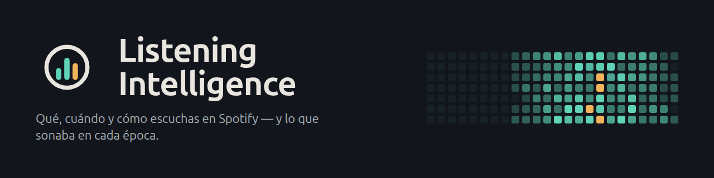
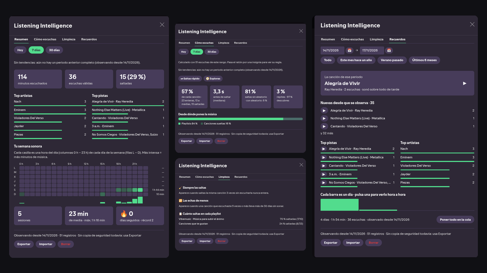

<p align="center"></p>

# Listening Intelligence

🇬🇧 English · 🇪🇸 [Español](README-ES.md)

A [Spicetify](https://spicetify.app) extension that records **what, when and how you listen** on Spotify and shows it in a panel. Everything stays on your machine.

> **Status: v0.1 beta.** It works and has 92 tests, but the history has only been tried with a few days of real use. The interface is in Spanish.

## What it does



An icon in Spotify's top bar opens a panel with four tabs:

| Tab | What you see |
|---|---|
| **Resumen** (Summary) | Minutes listened, valid and skipped plays, top artists and tracks, day × hour heatmap, sessions and day streak. Every figure shows its change against the previous period "at this same time" (▲ 18 %). Ranges: today, 7 days, 30 days. |
| **Cómo escuchas** (How you listen) | Habits with visible rules: attention, patience before skipping, shuffle, repeat vs. discovery, where you listen from. |
| **Limpieza** (Cleanup) | Songs you always skip, ones you miss, and the playlists where you skip most, with ▶ to check them. Read-only: it never touches your playlists. |
| **Recuerdos** (Memories) | Pick two dates (DD/MM/YYYY) and see what was playing: the song of that period, what you discovered, the tops, one bar per day (click one for an hour-by-hour view) and "Add everything to queue". |

Summary also shows **"This day last year"** when there is music from the same day a year ago (or, failing that, a month ago).

**What counts as a valid play:** at least 30 s playing or 50 % of the track, whichever comes first. Minutes count everything that played, skipped songs included.

## Privacy

- **Nothing leaves your machine.** No server, no accounts, no calls to the Spotify web API.
- History is stored in IndexedDB, inside the Spotify client itself.
- It only records what the extension sees from the moment you install it: it cannot recover earlier listening.
- **Export / Import / Delete** are in the panel footer. Delete asks for confirmation and only touches this extension's data.

### Back up now and then

Spotify keeps extension data in a **cache** folder. If you clear it, or reinstall Spotify, the history is lost. Use **Export** and save the `.json` file somewhere else; **Import** merges it back without duplicates. The footer reminds you when the last backup was. (The extension cannot back up automatically: Spotify does not keep write permission between restarts.)

## Optional companion: Musical DNA

Listening Intelligence works fully on its own. If you want to go one step further, [**Musical DNA**](https://github.com/D4vRAM369/musical-dna_spicetify) is an optional extension that reads this history (read-only) to show what defines your taste and suggest songs with a small recommender that learns from what you listen to. It is not required: install it only if you are curious.

## Installation

**Requirements:** Spotify desktop with [Spicetify](https://spicetify.app/docs/getting-started) installed.

1. Download `listening-intelligence.js`.
2. Copy it to Spicetify's `Extensions` folder. To find it:
   ```bash
   spicetify config-dir
   ```
3. Enable it and apply:
   ```bash
   spicetify config extensions listening-intelligence.js
   spicetify apply
   ```
4. Spotify restarts and shows the notice "Listening Intelligence registrando". The icon (a clock with bars) appears in the top bar.

To uninstall: `spicetify config extensions listening-intelligence.js-` then `spicetify apply`.

## Data format

The history is designed so other extensions (like [Musical DNA](https://github.com/D4vRAM369/musical-dna_spicetify)) can read it. Both run in the same Spotify page, so they can open the same database.

- **IndexedDB** `listening-intelligence`, version 1.
  - Store `records` (key `id`, index `startedAt`): one entry per play.
  - Store `meta` (key `"meta"`): `{ schemaVersion: 1, observingSince }`.
- The **Export** file has the same shape: `{ schemaVersion: 1, observingSince, open: null, records: [...] }`.

A record:

```json
{
  "id": "1794694392388-spotify:track:3jzVD4wI9bwSQBvKu1ifxD",
  "uri": "spotify:track:3jzVD4wI9bwSQBvKu1ifxD",
  "kind": "track",
  "title": "Spanish Guitar",
  "artists": [{ "uri": "spotify:artist:23wr9RJZg0PmYvVFyNkQ4j", "name": "Gary Moore" }],
  "albumUri": "spotify:album:4MhYmImJG6tKPgzRHxFfUm",
  "contextUri": "spotify:playlist:37i9dQZF1F5p3rmiWPIYgZ",
  "shuffle": "on",
  "durationMs": 237293,
  "startedAt": 1794694392388,
  "playedMs": 237785,
  "pauses": 0,
  "endedAt": 1794694630173
}
```

- Dates are milliseconds since 1970 (`Date.now()`).
- `kind`: `track`, `episode`, `local` or `other`. Statistics only use `track`.
- `shuffle`: `off`, `on` or `smart`.
- If the shape changes, `schemaVersion` will be bumped.

## Development

All code lives in a single file, in layers: pure logic on top (exported as `core`, no Spotify needed), capture and storage in the middle, interface at the bottom.

```bash
npm test      # 92 tests: pure logic + end-to-end against a simulated Spotify
```

Node 20 or newer. No dependencies.

To debug against real Spotify from the terminal:

```bash
flatpak run com.spotify.Client --remote-debugging-port=9222 &   # or the equivalent on your system
node --experimental-websocket tools/cdp.js 'ListeningIntelligence.store.records.length'
```

⚠️ With the debugging port open, any program on your machine can control Spotify. Close it when done.

Code comments cite identifiers like `D-024` or `Error #6`: they come from an internal design journal that is not part of the repository. Comments and the UI are in Spanish.

## Known limitations

- Only tested on Linux (Spotify flatpak, client 1.2.95).
- Not tested with Spotify Connect (playing on another device), nor thoroughly with podcasts or local files.
- With multi-year ranges, the per-day bars in Memories become very thin.

## License

[MIT](LICENSE).
